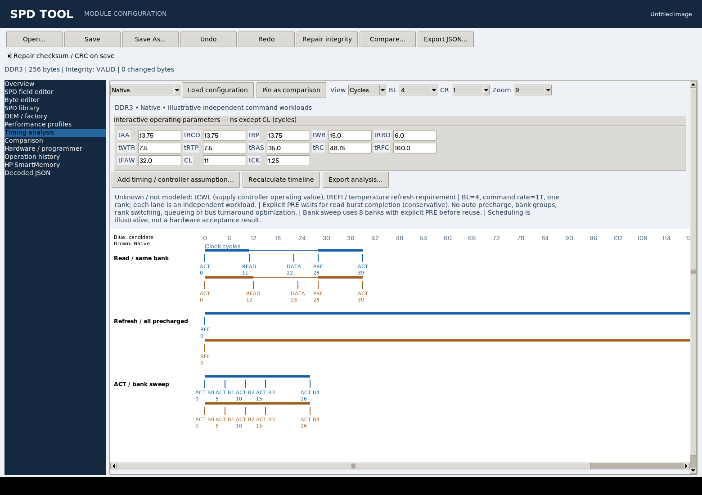

# SPD Tool

A Python toolkit for inspecting, comparing and editing SDR, DDR, DDR2 and
DDR3 Serial Presence Detect images. Includes a Tk editor, DDR3 RDIMM/LRDIMM
register fields, HP SmartMemory utilities, and Linux SMBus access.
The editor includes hardware discovery, acquisition and reviewed programming,
with an optional USB serial interface for standalone microcontroller fixtures.
An offline firmware scanner extracts embedded SPD candidates from BIOS images
and unpacked UEFI sections, including low-power memory signatures.

## Support

| Memory family | Decode and JSON export | Binary patching | Named module fields |
| --- | --- | --- | --- |
| SDR SDRAM | Yes | Yes | Geometry, timings, capabilities, register/buffer attributes |
| DDR SDRAM (DDR1) | Yes | Yes | Geometry, timings, capabilities, register/buffer attributes |
| DDR2 SDRAM | Yes | Yes | Organization, capabilities, native timings and full/abbreviated UDIMM EPP |
| DDR3 SDRAM | Yes | Yes | Standard organization, native timings, XMP, RDIMM/LRDIMM register/buffer settings |

DDR3 support includes JEDEC timings, XMP profiles, manufacturing data and HP
HPT blocks. Reserved and vendor-specific bytes remain accessible in the byte
editor. DDR4 catalog recognition and ee1004 reads are separate from the core
decoder; DDR4/DDR5 editing, FBDIMM and Rambus formats are outside its scope.

## Requirements

- Python 3.9 or later; no third-party Python packages required.
- Tk and a graphical display for the editor. On Debian/Ubuntu, install
  `python3-tk` if it is not included with Python.
- Linux I2C device access for `spd_smbus.py`.
- Optional `pyserial` for the external USB bridge (`requirements-bridge.txt`).
- Optional `py7zr` for 7z collection import (`requirements-archives.txt`).

Run commands from the repository root. The examples use `python`; substitute
`python3` where required by the local installation.

## Quick start

```sh
git clone https://github.com/rigred/spd_tool.git
cd spd_tool

# Inspect an image, including offsets and raw fields.
python spd_tool.py dump --spd module.bin --programmer

# Open the editor.
python spd_tool.py gui --spd module.bin

# Export decoded data.
python spd_tool.py dump --spd module.bin --json module.json

# Compare images.
python spd_tool.py diff --file-a original.bin --file-b modified.bin --show-maps
```

The loader accepts binary images, hex-text dumps, Thaiphoon TH20 dumps and
single-image open SPD bundles. Supported editable images contain 128-256 bytes. Image
length is preserved. See [Image formats](docs/FORMATS.md) for text syntax,
partial images and checksum coverage.

## Editing

The Tk editor opens on a structured module overview with identity, capacity,
organization, timing limits, operating profiles and integrity diagnostics.
Dedicated pages provide a generation-aware field editor, byte editor, OEM/factory
customization, performance profiles, interactive timing analysis, operation history,
HP SmartMemory tools and image comparison. Decoded JSON remains available for
advanced inspection. Double-click a byte or
module setting to edit it. The register view supports group and text filters;
**Show raw control/personality words** exposes expert fields. Edits support
undo/redo. Save writes a binary image and repairs its checksum/CRC by default.

Named fields are also available from the CLI:

```sh
# Inspect field keys, encodings and current values.
python spd_tool.py fields --spd rdimm.bin --expert

# Set CA drive strengths using the codes listed by fields.
python spd_tool.py edit --spd rdimm.bin --out modified.bin \
  --set ca_a=1 --set ca_b=2

# Edit an LRDIMM termination setting and personality nibble.
python spd_tool.py edit --spd lrdimm.bin --out modified.bin \
  --set 1333_1600.rtt_nom=3 --set F15RC6=0xA

# Copy a part number from a compatible donor image.
python spd_tool.py patch --source donor.bin --target module.bin \
  --out modified.bin --copy-partnum
```

Named edits preserve neighboring bits and validate the field encoding. Delay
fields accept engineering units and exact fractions; `0x` values select raw
encoded counts. Patch ranges use inclusive endpoints.

Register values depend on the board layout, component revision and DRAM
loading. Firmware may override SPD register words. A valid checksum establishes
image integrity; it does not establish electrical compatibility or successful
memory training. EEPROM programming is available in the editor's
**Hardware / programmer** page and through `spd_smbus.py`. The GUI presents
target identity and exact changes, saves a full backup and requires complete
read-back verification. See the [hardware GUI guide](docs/GUI_HARDWARE.md) and
[external bridge setup](docs/EXTERNAL_BRIDGE.md).

## SPD library

The top-level **SPD library** area imports files or folders into a portable SQLite
collection with readable manufacturer/model paths and hash deduplication. Its
expandable file list has independent scrollbars and collapsible filters/details.
Reviewed removal uses restorable collection trash; missing external source
references can be cleaned without deleting managed snapshots.
It includes HP family evidence analysis, reusable multi-donor merge recipes, optional
startup loading, source refresh and offline public-submission bundles.
See [Library management](docs/LIBRARY.md) and
[Desktop release builds](docs/RELEASES.md). Vendor observations and reviewed
[HP donor profiles](docs/VENDOR_PROFILES.md) support matching generic modules
while preserving their serials and original hardware configuration.

## XMP and timing proposals

**Performance profiles** provides native SPD timing editors for all four families,
DDR2 full/abbreviated EPP authoring and DDR3 XMP editing/creation. The native page
includes an acknowledged XMP-to-primary timing conversion preview. **Timing
analysis** displays editable command timelines and configuration comparisons. The timing planner generates
faster-clock proposals for SDR through DDR3 from SPD anchors, user-reported
tests and manually transcribed chip-datasheet constraints. Generated values
remain untested proposals. See [Engineering workbench](docs/ENGINEERING_WORKBENCH.md),
[feature coverage](docs/COVERAGE.md) and [XMP and timing planning](docs/XMP_TIMING_PLANNER.md).



The diagram above uses a synthetic SPD fixture; it illustrates command constraints,
not a measured hardware result.

## THP conversion and open bundles

TH20 imports decode directly into normal binary images in the library; original
wrappers are retained separately. Bulk file/folder import also accepts ZIP archives
and optional 7z collections. Conversion preserves the original SPD checksum/CRC,
including invalid values.

```sh
python spd_tool.py convert --source module.thp --out module.bin
python spd_tool.py library-import --collection ./collection --source SPDs.7z
python spd_tool.py convert --source module.thp --out module.spdz
```

[Open SPD Bundle v1](docs/OPEN_SPD_BUNDLE.md) uses ordinary ZIP, a UTF-8 JSON
manifest, plain binary images and SHA-256 checksums. It is a documented project
interchange format, with no obfuscation or proprietary runtime. See
[THP import and format details](docs/THP_IMPORT.md) for supported layouts and
`requirements-archives.txt` for optional 7z support.

## Documentation

- [Engineering workbench](docs/ENGINEERING_WORKBENCH.md): compatibility, multi-donor
  composition, native/EPP/XMP previews, timing diagrams and catalog preferences.
- [Coverage matrix](docs/COVERAGE.md): generation-specific scope and validation boundaries.

- [Command reference](docs/CLI.md): inspection, editing, donor patches,
  cataloging, conversion and hardware access.
- [Registered modules](docs/REGISTERED_MODULES.md): DDR3 RDIMM/LRDIMM fields,
  personality mappings, legacy registered modules and HP SmartMemory.
- [Image formats](docs/FORMATS.md): offsets, integrity checks, timing units,
  manufacturing IDs and format boundaries.
- [Hardware acquisition](docs/HARDWARE.md): Linux transport selection,
  consistency checks, HP Gen8 diagnostics and explicit programming.
- [GUI hardware workflow](docs/GUI_HARDWARE.md): adapter scans, acquisition
  quality, target selection, change reviews, backup and verification.
- [External bridge](docs/EXTERNAL_BRIDGE.md): bench fixtures, reference MCU
  firmware, USB serial setup and the SPD1 protocol.
- [Embedded SPD extraction](docs/FIRMWARE.md): BIOS image scanning, compressed
  sections, memory-down profiles and extraction confidence.
- [Development](CONTRIBUTING.md): source layout, tests and decoder extensions.

Use `python spd_tool.py --help` or a subcommand's `--help` for option details.

## Tests

```sh
python -m unittest discover -v
```

Tk integration tests run when a display is available. Tests cover decoding,
bitfield edits, checksum handling, file operations, CLI commands and the
bundled sample images. Hardware programming and boot behavior require
validation on the target platform.

## License

MIT. Source files carry SPDX license identifiers where applicable.
