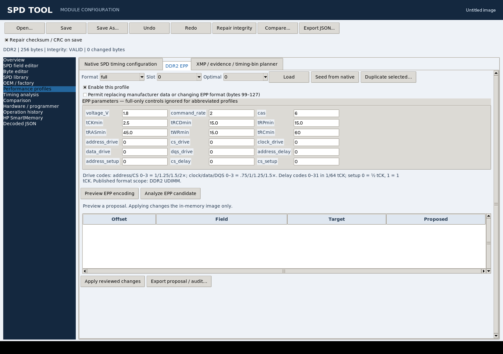

# Engineering workbench

Open an SPD image with `python spd_tool.py gui --spd module.bin`. Navigation on
the left separates image inspection, structured editing, collection management,
OEM customization, performance profiles, timing analysis and physical programming.
All engineering operations work on the loaded image. They do not access a bus.

## Review levels

| Level | What the tool establishes |
| --- | --- |
| Structural integrity | Expected image size/type and the applicable base checksum or CRC |
| Logical consistency | Representable values and implemented timing/dependency checks |
| Inferred compatibility | Agreement of the available SPD hardware descriptors, with recorded review assumptions |
| Verified operation | Operator-supplied test evidence; software calculations do not establish it |

Keep the original dump. Preview substantive changes, apply them to memory,
then use **Save As** or archive the editor image in the collection. Undo and
Redo restore image bytes. **Operation history** retains the session audit;
export it to retain the full record outside the collection. A binary image
alone does not carry source, override or test provenance.

## OEM / factory customization

The target identity summary shows the current image, organization, timing point,
integrity and HPT value. With a collection open, donor discovery runs when the
target or collection changes. **Find catalog donors** refreshes the search;
**Add donor file** permits inspection without importing a file first.
Incompatible entries are hidden unless explicitly requested.

Select a donor to inspect the compatibility explanation and field comparison.
Manufacturing identifiers, raw field masks, semantic timing values and opaque
regions remain separate. This distinction matters: an OEM sticker part number
belongs in collection annotations unless its actual SPD encoding is known.

| Classification | Meaning |
| --- | --- |
| Exact match | Compared encoded hardware descriptors and manufacturer PN agree; no detected timing/component variation |
| Hardware-equivalent | Compared fundamental descriptors agree, with timing or register supplier/revision differences |
| Conditional match | Manufacturer PN/identity differs or is incomplete; physical-equivalence review is required |
| Incompatible | Memory generation, encoded geometry, module architecture or base integrity prevents the operation |

These labels describe the available SPD evidence. They do not establish chip
speed grade, PCB routing, electrical qualification or genuine OEM origin.

### Compose selected fields

1. Choose a donor and an editable preset, or select individual rows.
2. Enter the review evidence required for the selected operation.
3. **Queue selected fields**. Repeat with other donors to compose a profile.
4. **Preview composition**. Conflicting donor bits or semantic timings require
   an explicit source choice. The conflict source list uses SHA-256 prefixes.
   Additional conflicts may require another preview/source selection.
5. Review byte differences and apply the exact proposal to the in-memory image.

Target identity and timings are preserved unless selected. Geometry and wiring
rows are inspectable but cannot be transplanted through the merger. Change a
physical descriptor deliberately through the field editor only when it describes
the actual module.

Review reasons are scoped to hardware equivalence, timing imports, register
component equivalence, opaque payloads and identity replacement. One reason does
not waive an unrelated check. Generation, geometry and architecture blockers
cannot be overridden. Timing-only differences do not block metadata transfer.
A register supplier difference does not authorize copying its control words;
register transfers require documented equivalence when components differ.

Individual native timing parameters and the complete native timing set are
transferred semantically through the generation encoder. Known extension blocks
remain atomic. EPP/XMP payload transfers require timing review in addition to
opaque-region review. Unknown payload semantics are never inferred from a
signature or printable string. Their private dependencies/checksums remain
unverified even when the base CRC is valid.

### Reusable recipes

Save a recipe **before applying** its preview. The JSON bundle contains the
original target, donor images, selected fields/masks, review reasons, explicit
conflict resolutions and expected result hash. It can be replayed only against
the exact original target hash. Replay verifies donor and result hashes.

When a collection is open, saving also stores the recipe and generated result
in SQLite. Select it with **Preview saved catalog recipe**, or reopen an exported
bundle with **Replay recipe**. Generated results carry provenance and are excluded
from independent HPT family evidence. Recipes contain raw serial numbers and
vendor data; review them before sharing.

### HP SmartMemory

Saved HP donor profiles appear in **Find HP profiles** when their hardware
assessment permits the target. **Compute candidates** uses the existing validated
family relation and the target's own serial. Select an HPT candidate explicitly
when several solutions exist, then **Preview target HPT**. Target serial, factory
identity and timings are retained. Existing customer payload replacement remains
explicit. HPT is computed separately from raw donor-region composition: the
merger refuses to copy serial-bound HPT blocks.

Use **Catalog HPT families / donor profiles** for creating profiles, mining and
reviewing family evidence. **Edit target OEM sticker details** stores OEM part,
spare, assembly and family numbers plus observed chip PN, PCB revision and
register PN. These annotations are operator observations, not data decoded from
the EEPROM. They do not silently waive compatibility checks.

A structural HPT signature or an equation match does not guarantee SmartMemory
recognition by any server firmware. See [HP donor profiles](VENDOR_PROFILES.md).

## Native and extended performance profiles

**Performance profiles → Native SPD timing configuration** loads the applicable
SDR, DDR, DDR2 or DDR3 timings and supported CAS values. Values are in nanoseconds;
CAS values are clock counts. Preview uses native units and conservative upward
rounding for timing minima. Access-time maxima describe the part's declared
performance; rounding upward reports a slower bound. Legacy lower-CAS operating
points are invalidated when their shared CAS bitmap changes. Other image bytes
and image length are retained; base integrity is repaired.

DDR3 uses its own MTB/FTB and signed corrections. DDR2 uses its fractional cycle
codes, quarter-nanosecond minima and extended tRC/tRFC fields. SDR and DDR use
their actual legacy encodings. Unrepresentable or incoherent values are errors,
not silent clipping. See the [coverage matrix](COVERAGE.md) for scope boundaries.

### DDR2 EPP

The EPP page implements NVIDIA's full (two 12-byte profiles) and abbreviated
(four 6-byte profiles) layouts in bytes 99–127. The published format is scoped
to DDR2 UDIMMs. RDIMM, SO-DIMM and other-generation creation is refused.

Load an existing slot, seed a draft from native timings, or duplicate a slot.
Choose the format, slot and an enabled optimal profile. Full profiles expose
voltage, command rate, CAS, cycle/primary/secondary timings, drive strengths,
address/CS setup and delay codes. Abbreviated profiles contain only their
specified subset. The form states drive multipliers and delay units.

Creation over populated manufacturer bytes or changing the extension format
requires explicit replacement permission. Editing an existing format preserves
unrepresented bits and other slots. The special 1.875 ns EPP clock code is
supported. Voltage encoding range is not a recommended operating range.
The base SUM8 does not cover EPP; no invented extension checksum is added.

Layout references: the [i2c-tools upstream decoder](https://sources.debian.org/src/i2c-tools/4.4-3/eeprom/decode-dimms/) is cross-checked for DDR3 package descriptors; NVIDIA [EPP specification SP-02496-001 rev. 01](https://www.nvidia.com/content/epp/epp_specifications.pdf).

### XMP to primary timing conversion

In the native page's **Danger Zone**, choose an enabled XMP slot and acknowledge
that the settings were tested on the intended hardware. **Preview native
conversion** translates timing meanings into native DDR3 fields; it does not
copy extension bytes. tRC is kept at least as large as the quantized tRAS+tRP.
The XMP block, hardware descriptors and manufacturing information are preserved.

The preview reports source voltage and untranslated assumptions. Arbitrary XMP
VDD, CWL, tREFI, command rate and controller behavior cannot all be expressed in
the primary fields. The BIOS may choose a different operating point. Acknowledgment
records the operator's statement, not a software-verified test result. Apply is
undoable and saving/programming remains separate.

### Timing-bin generation

The integrated **XMP / evidence / timing-bin planner** accepts SDR through DDR3.
Generate candidates from the SPD anchor, manually transcribed datasheets or
user-reported test points. **Analyze proposal** sends the result to Timing
Analysis. **Preview native SPD proposal** uses the native encoder for the loaded
generation and retains the proposal/evidence in provenance. Unsupported CAS
values or timing representations stop native encoding. DDR3 candidates can
also populate the XMP editor. See [timing evidence](XMP_TIMING_PLANNER.md).

## Timing analysis

Load native, XMP or EPP configurations directly. OEM donor comparisons and the
timing-bin planner can send configurations to the same page. Edit timing inputs,
press Enter or leave the field to recalculate. Add missing controller/datasheet
parameters explicitly; unknown values remain listed. CL uses cycles; other
inputs use ns. Configure burst length and command rate as operating assumptions.
Use **Pin as comparison** to overlay the prior schedule. Switch ns/cycle views,
zoom horizontally, and click commands/windows for dependency explanations.

The diagram contains independent illustrative workloads: read/precharge/reactivate,
write recovery, write-to-read, all-precharged refresh, bank ACT sweep and repeated
column commands when the necessary inputs are present. It uses cycle-quantized
minimum constraints. The ACT sweep enforces tRRD and applicable rolling tFAW;
known four-bank modules explicitly precharge before bank reuse and enforce tRC.
Read PRE conservatively waits for the full read burst as well as tRTP and tRAS.

Missing tRFC, read-to-precharge, CWL or other requirements suppress the affected
schedule rather than implying zero delay. Supply generation-appropriate operating
values from the actual datasheet/controller. SDR/DDR do not receive an invented
tFAW. tREFI is a maximum refresh interval, not a minimum command delay.

This is not a memory-controller simulator. Lanes are separate workloads, not
simultaneous commands on a shared bus. It does not model rank turnaround,
queueing, auto-precharge optimization, power/thermal behavior or application
throughput. Assumptions and gaps accompany exported analysis. A shorter command
schedule is not evidence of stable hardware or faster applications.

## Collection preferences

Choose a collection, set filters/sort and optionally enable **Load this collection
at startup**, then **Save catalog preferences**. The last selected collection is
remembered; autoload is opt-in. Startup checks for an existing database and does
not create a missing collection. Loading uses the background job system.

Preferences are atomically saved in `spd-tool/settings.json` under
`SPD_TOOL_CONFIG_DIR`, Windows `APPDATA`, `XDG_CONFIG_HOME`, or `~/.config`, in
that order. Malformed preferences are ignored. An unavailable collection is
reported in the library page.

**Refresh source files / index** reimports accessible original file paths by
content hash. A changed source becomes a new immutable image; existing images,
annotations, recipes and donor relations remain. Duplicate content is not
added again. Missing paths and parse failures are reported. An edited managed
artifact is not silently trusted: normal catalog hash verification still fails.
