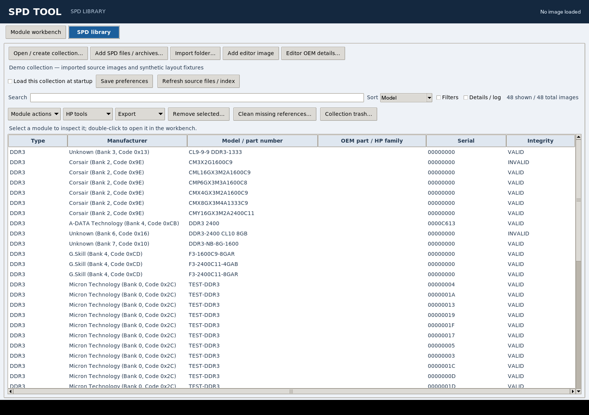

# SPD library

The top-level **SPD library** area integrates collection management with the editor.
Choose **Open / create collection** and select a writable folder. The collection
contains a portable `library.sqlite3` database and exact binary copies under:

```text
modules/<memory type>/<manufacturer>/<model>/<serial>--<SHA-256>.bin
```

Names are sanitized for Windows and Unix filesystems and components are kept
short. Keep the collection root short when targeting Windows installations
without long-path support. Move/copy the entire collection together; database
paths are relative. Do not edit managed copies outside the editor. Hashes are
checked when reopening them.

## Import and edit

Use **Add SPD files / archives** for binary, TH20, supported text dumps or archives, **Import folder**
for a recursive batch, or **Add editor image** to capture the current editor
buffer, including unsaved changes. Imports never move or repair the source.
Identical bytes share one database entry while source references are retained.
Different dumps with the same serial remain distinct. Invalid checksums remain
visible for recovery work. Errors are reported per file.

Imports use the core SDR/DDR/DDR2/DDR3 decoder and its 128-256-byte limits.
Large firmware images must first be extracted with the firmware scanner. Individual image sources larger than 1 MiB and symbolic links are rejected;
archives have separate bounded expansion limits. Folder imports are limited to
10,000 candidate files and consider `.bin`, `.spd`, `.thp`, `.rw`, `.hex`, `.txt`,
`.zip`, `.spdz` and `.7z`. Managed `modules/` and `originals/` directories are
skipped when importing a collection root. An import result's accepted count includes duplicates encountered.

Enable **Filters** and use the dropdowns to combine module vendor, DRAM vendor, memory generation,
module type, capacity (MiB), SPD maximum speed (MT/s), ranks, ECC, integrity,
HPT presence, image size and manufacturing year. The From/To year controls are
inclusive; applying a bound excludes unknown dates. Unknown dates remain an
explicit year filter choice. Dates come from SPD, not filesystem timestamps.
Sort by model, vendor, manufacturing date, capacity, speed or serial. Unknown
values sort last. Clear filters resets search, dropdowns, date bounds and sort.

Existing collections are automatically backfilled with this metadata on open.
The original source references and managed filenames are retained. The table
reports filtered and total image counts.

Select one row and choose **Module actions → Open selected in editor**. The editor receives a snapshot;
Save As and subsequent **Add editor image** preserve a modified version without
overwriting the archived original. Search matches identity, integrity and hash.

The historical `sort_spd.py` SQLite/HTML organizer remains available. Its old
SQLite schema is not rewritten or opened as the new database. To bring an old
collection into this interface, import its organized binary folder into a new
collection. Existing JSON/HTML indexes are not needed and are left untouched.
DDR4 records in the old organizer remain there until core catalog support is
extended; the GUI reports those imports as unsupported.

## OEM sticker details

**OEM sticker details** edits the selected library entry. **Editor OEM details**
archives the current editor snapshot if needed and edits its annotations. Fields
include OEM name, OEM part number, spare/replacement number, assembly number,
model/product, HP HPT family PN and notes. Blank fields remove previous values;
clearing all fields removes the annotation. No SPD bytes, module manufacturer
part number or hash are changed. The annotations are stored separately in the
collection database with user-entry provenance and a UTC timestamp.

Entries with identical SPD bytes share annotations because the library is
content-addressed, not a physical inventory system. Preserve multiple sticker
observations in notes when necessary. Opening a library entry in the editor
retains its annotation context; **Add editor image** carries those details to a
new edited snapshot in the same collection when that snapshot has no existing
annotations. Opening another file or reading another device creates a new
editor document and does not inherit the previous module's labels.

OEM names and part numbers are searchable; an OEM dropdown and OEM part/family
column are included. Submission manifests retain the actual SPD-derived
`part_number` and include user-entered sticker details separately under `oem`.
Manual labels are never presented as values decoded from the EEPROM.

### HP/HPE family grouping across vendors

For OEM names HP, HPE, Hewlett-Packard or Hewlett Packard Enterprise, analysis
uses the explicit **HP HPT family PN**, falling back to **OEM part number**.
If the family identifier is on a spare or assembly label, copy that number into
the explicit family field. Spare and assembly numbers are retained separately;
the tool does not guess which sticker identifier defines the HPT family.

A matching manually entered HP family PN groups samples across module vendors,
vendor part numbers and module layouts. HP can source the same labeled assembly
from several suppliers. Original vendor identities and per-image annotation
provenance remain in the evidence report. An OEM PN is a grouping hint, not
proof of a relation: distinct serial counts, integrity checks, HPT consistency,
conflicting-serial detection and review-before-save still apply to the combined
group. Inconsistent revisions are not automatically split into guessed families.
Other OEMs' part numbers do not enter HP grouping. Modules without an HP family
annotation retain the previous vendor/model/organization grouping.

Saved families are scoped to that HP PN when supplied. Changing/removing an
evidence module's annotation invalidates reuse of an affected saved relation
until it is mined and reviewed again. Exported family registries include the
scope and original vendor part aliases so downstream consumers can inspect how
the relation was obtained.

## HP SmartMemory

**Analyze HPT family** examines the selected DDR3 model. **Compute HPT for editor
serial** evaluates that selected model's family for the current DDR3 editor
serial; explicitly verify the editor module belongs to the selected family.
Results are displayed as JSON, including coefficients, provenance, possible
HPT values and limitations. They do not program hardware or change an image.
Use the editor's HP SmartMemory tab to apply a deliberately chosen value.

Registered family lookup uses normalized exact part numbers and listed aliases.
For an unregistered model, local evidence is grouped by an explicitly supplied HP family PN, or otherwise
by manufacturer, model and module organization. Only integrity-valid images with a complete HPT tag count.
Repeated images or repeated serials do not count as independent evidence.
Conflicting HPT values for one serial prevent local inference.

Two distinct serial/HPT pairs define a **provisional** modular relation. Three
or more matching samples are labeled **sample-consistent** only when every
available sample satisfies it. Neither label establishes an authentic HP
family, cryptographic validity or compatibility. An inconsistent group yields
no inferred family. Degenerate relations and more than 1024 possible HPT values
are not enumerated. Multiple solutions remain visible rather than selecting
one silently. Selected-image analysis can compute a relation without saving it.

### Mine and save families

**Mine HPT families** scans the whole collection, independent of the current
filters. It groups integrity-valid DDR3 HPT samples by exact normalized module
part number, manufacturer and module organization, unless an explicit HP
family PN supplies the cross-vendor grouping described above. Each group reports evidence
hashes, distinct serial count, known registry matches and one of: insufficient,
conflicting-serial, inconsistent, underdetermined, unreadable-evidence or candidate. Constant-HPT
relations are explicitly flagged. Duplicate serials do not increase the count.
Two-sample candidates remain provisional; three or more must all satisfy the
relation. Multiple HPT solutions remain visible and bounded at 1024.

Select a group to review the coefficients and evidence, then choose **Save
reviewed family to collection**. Supply a descriptive label, or a known HP spare
part number if independently established. The tool does not infer an HP spare
part number from the module's manufacturer part number. After confirmation,
the collection is mined again: changed evidence, conflicts or a different
already-saved coefficient set abort the save. Saving records the evaluation,
coefficients, model/organization scope, source hashes and UTC timestamp in the
collection's SQLite database. The bundled global registry is never overwritten.

Saved relations are reused by selected-model HPT analysis. Newly imported
contradictory evidence blocks computation from an affected saved relation.
**Export saved families** writes a new JSON registry file for review and manual
merging or sharing; existing output files are not replaced. Empirical matches
remain consistency evidence rather than proof of authentication.

## Public submission interface

Select one or more rows and choose **Export → Public submission**. After an
explicit disclosure prompt, the tool creates a new ZIP with raw images and a
versioned `spd-tool-submission/2` manifest. Each image entry includes its actual
`part_number`, module and DRAM manufacturers, memory/module types, serial,
manufacturing date/year, capacity in MiB, speed in MT/s, ranks, ECC, integrity,
HPT presence/code, length, SHA-256 and archive filename. Unavailable values stay
null/Unknown; no family identity is invented. Metadata is freshly decoded from
the hash-verified raw image, rather than trusting the database's display cache. Absolute source paths are omitted;
raw images retain serial numbers and vendor data. Review the archive before
publishing it. Existing output files are not replaced.

No public endpoint is configured and no network upload is performed. This
export is the integration boundary for the future service. A service adapter
must add endpoint configuration, explicit publication consent, transport and
server validation, authentication where required, and durable receipt/error
handling. Offline bundles must remain usable without an account or network.

## Vendor observations and donor profiles

**Vendor data / profiles** inspects decoded IDs and observed vendor regions,
and manages serial-preserving HP HPT templates for matching manufacturer PNs.
See [Vendor metadata and HP profiles](VENDOR_PROFILES.md) for compatibility
checks, explicit HPT solution selection, opaque-byte options and generated-data
provenance. Profile-generated entries are excluded from family mining.


## THP and open-bundle imports

File and folder imports accept TH20 `.thp`, supported `.rw`, raw/text images,
ZIP/open bundles and optional 7z collections. Normalized `.bin` images are stored
under the collection hierarchy; original nonbinary sources and conversion hashes
are retained separately. Unknown members are reported individually during generic
archive import. Open bundles require complete manifest/hash verification first.

Use **Export open bundle** for selected images, OEM details, provenance and original
sources. See [THP conversion](THP_IMPORT.md) and the
[open format specification](OPEN_SPD_BUNDLE.md).

## Dedicated library area and file-list space



The image combines supplied imports and explicitly labelled synthetic layout fixtures.

Use the **SPD library** button at the top of the application. The library is
separate from the module editor's sidebar. The editor's save/undo controls and
sidebar are hidden while browsing the collection; **Module workbench** returns
to the last editing page. Opening a selected collection image returns to the
module workbench automatically.

The file list expands with the window and has independent vertical and
horizontal scrollbars. Filters and the details/log pane start collapsed.
Enable **Filters** for vendor, type, capacity, speed, rank, integrity and date
controls; enable **Details / log** for import results or advanced reports.
When details are shown, drag the divider to allocate more space to the list.
Rejected bulk-import entries open the log automatically. Double-click a row
to open it; use **Module actions**, **HP tools** and **Export** for operations
on the selection.

## Remove entries and restore collection trash

Select one or more rows and choose **Remove selected**. The review shows the
modules, managed-file paths and counts of dependent donor profiles, merge
recipes and learned HPT families. Dependent records require an explicit
checkbox before removal can proceed. A stale review is rejected if collection
records or reviewed files change.

Removal moves managed `.bin` images and unshared retained originals into a
`.trash/<removal-id>/` package under the collection. Database records, annotations,
generated-image provenance and affected dependencies are retained in its
manifest for restoration. Shared original sources remain active while another
image refers to them. External source files are never moved or deleted, and
the currently open editor buffer is retained.

**Collection trash → Restore selected package** restores files and metadata,
including dependent profiles and learned families. Restoration verifies the
quarantined bytes and refuses to overwrite changed metadata or files. Matching
already-restored records can be reused, including recovery after an interrupted
removal. Missing managed artifacts can be removed from the index too; restoring
such a removal cannot reconstruct bytes that were already absent.

Trash is retained until **Permanently empty selected packages** is explicitly
confirmed. This frees the quarantined files and cannot be undone. Removing a
collection entry is therefore distinct from permanently deleting its trash.

## Clean missing external references

**Clean missing references** previews stale external source-file pointers.
Applying that review removes only those pointers from the source index:
managed binary snapshots, retained original wrappers, annotations, profiles and
external files remain untouched. A source that reappears before cleanup is
retained. Virtual observations such as `editor snapshot` are not treated as
filenames. Unreadable or ambiguous legacy relative paths are reported and kept
for manual review; new imports record absolute external source paths.

A missing external source does not mean that its normalized library snapshot
is missing. To remove a missing managed image's index entry, select that module
and use the separate removal review. Older collections with unreadable artifacts
can still open for review; failed metadata migration is reported rather than
silently deleting records.
